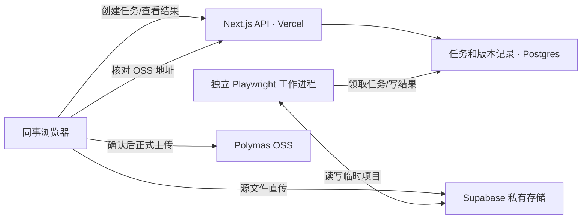

# 在线预检、确定性修复、复检与确认发布设计

## 1. 目标与交付边界

同事只使用已上线的 Agent Eval 网页：选择本地静态 HTML 项目文件夹，查看预检结果，确认可确定的资源路径修复，复检通过后再点击发布。普通使用者不安装 Codex/Qoder skill、Node.js 或 Playwright。上传前不调用 Polymas 正式资源上传接口。

首版自动修复只处理**可以由现有文件唯一确定目标**的路径错误。缺失素材、业务含义、登录后流程及不明确的动态拼接留给人工处理，并在界面显示阻断原因。系统报告检查覆盖范围，不宣称覆盖所有隐藏交互。

## 2. 现状与架构选择

- 现有 `frontend/lib/project-publish-preflight.ts` 已提供资源扫描、文件指纹、平铺模拟和与正式发布共用的改写顺序；`frontend/scripts/project-publish-preview.mjs` 已使用 Playwright 巡检；`ResourceUploadInterface.tsx` 当前要求导入本地生成的报告。
- 主站部署在 Vercel，仓库已有 Supabase 登录能力及独立服务的部署先例。Vercel Function 请求体限制为 4.5 MB，项目文件不经主站 API 转发，而由浏览器直传临时私有对象存储。浏览器巡检使用单独的 Node.js 24 + Playwright 容器工作进程。第一版可部署为独立 Railway 服务，沿用现有团队的部署方式。
- 临时文件使用 Supabase Storage **私有 bucket**，任务和版本状态使用 Supabase Postgres。工作进程持有服务端密钥，主站浏览器只获得对应任务的限时上传许可；Polymas Authorization/Cookie 不发给巡检进程。
- 正式发布沿用浏览器内的 `executeProjectPublish`、OSS 验证和 IndexedDB 复用逻辑。服务端交付已经复检的**不可变版本**文件清单；浏览器重新计算指纹并只发布该版本。原项目及已修复版本均可下载为 ZIP。

依据：[Vercel Function 限制](https://vercel.com/docs/functions/limitations)、[Supabase 断点续传](https://supabase.com/docs/guides/storage/uploads/resumable-uploads)、[Supabase 私有 bucket](https://supabase.com/docs/guides/storage/buckets/fundamentals)、[Playwright 容器运行](https://playwright.dev/docs/docker)。

## 3. 同事看到的完整流程

1. **选择项目**：网页选择文件夹、入口 HTML；浏览器先显示文件数、总大小和忽略文件。网页可立即运行轻量静态扫描，给出明显缺失文件的早期提示。
2. **创建在线预检任务**：用户明确点击“开始在线预检”。浏览器把目录清单和文件直接传到临时私有存储；显示上传和巡检进度。此步是临时暂存，尚未向 Polymas 发布。
3. **自动巡检**：服务端校验清单和文件哈希，使用现有发布器生成随机平铺地址，检查所有 HTML 页面、CSS/JS/SVG/图片和已配置关键流程。结果按“阻断 / 可自动修复 / 需人工处理 / 外部依赖提示”展示，并注明逐页与交互覆盖数。
4. **提出修复稿**：仅针对确定性路径问题生成候选版本；网页展示每个文件的原文与修复差异、修改理由，以及未解决的问题。用户可整批或逐项接受。拒绝则保留原版本。
5. **重新巡检**：接受的修复产生新的不可变版本、新指纹；静态扫描和浏览器巡检从头运行。失败则回到诊断和修复界面；成功则解锁“确认发布”。
6. **确认并发布**：界面显示最终版本、发布文件数、跳过文件、警告、报告有效期和预期新入口链接。用户点击确认后，浏览器读取已锁定版本，通过既有上传器逐个上传并验证 OSS URL；完成后提供新链接、复用数量、下载修复后项目的入口。

网页关闭后可凭登录账户恢复任务。线上修复不直接覆盖同事电脑里的原项目；用户需要本地留存时下载修复后的 ZIP。重复发布时可选择已保存的版本，不必重新修复；**若浏览器缓存仍在**，未变化且可验证的 OSS 文件继续复用。

## 4. 自动修复范围

| 情况 | 首版行为 |
| --- | --- |
| 引用路径大小写与唯一真实文件不一致 | 修改引用文字，保持文件名原样；展示差异并复检 |
| `./`、`../` 或目录前缀错误，但仅有一个合理目标 | 改成相对当前 HTML/CSS/JS 所在文件的项目路径；复检 |
| HTML/CSS/SVG 的静态引用缺少目录，而目标唯一 | 修改引用；不预先写入随机 OSS URL |
| 路径中把目录接在完整 `https://...` URL 前 | 在可确定原始目标时纠正；否则阻断并提示 |
| 同名多候选、动态 JS 字符串拼接、运行时 JSON/wasm | 不自动猜测；列出候选和代码位置，交给人工或后续模型修复 |
| 项目里根本没有对应图片、字体或脚本 | 阻断，要求补真实文件；不生成占位资源 |
| 外部 HTTPS 图片或 API 失败 | 单独标记外部依赖；项目声明其为必需资源时阻断，否则要求用户确认风险 |

确定性修复器只修改文本资源，按修改前哈希应用补丁，防止任务运行期间源文件变化造成误改。修复算法复用 `resolveProjectReference`、`find*References`、`rewrite*References`，避免建立第二套不一致的路径规则。模型辅助修复可以在下一阶段增加，但建议仍执行“候选差异 → 人工确认 → 完整复检”的相同门禁。

## 5. 页面巡检与发布门禁

- 发布依据绑定 `jobId + revisionId + entryPath + manifestHash + ruleVersion`，报告由服务端任务状态保存，不再依赖用户自行导入 JSON。任何文件、入口、流程配置或规则版本变化都会创建新版本并令旧报告失效。
- 扫描所有 HTML；检查页面异常、失败请求、图片解码、CSS/JS/SVG 依赖及未完成请求。对外部依赖和未覆盖交互显示明确状态。
- 关键流程沿用 `polymas-publish-flows.json`，同时提供网页编辑器和常用操作模板。多页面或含明显动态导航的项目若没有关键流程，界面不得显示“完整巡检通过”；先要求补流程或以“仅逐页检查”的限制状态交由负责人明确确认。
- 入口页面通过不等于子页面独立直达通过。需要独立直达的项目将每个子页面单独打开并检查；若运行时映射依赖入口预热，直接访问失败应作为对应发布模式的阻断项，不能拿同会话预热代替。
- “确认发布”前检查报告不超过 24 小时、最终版本指纹一致、阻断项为零。正式 OSS 上传后继续验证链接可访问性、大小与 HTML 响应头；真正的公网交互验收结果单列，不用本地模拟结果替代。
- 新发布一般得到新的入口 OSS URL。旧链接和已分享页面不自动更新；固定入口或版本回滚属于后续独立功能。

## 6. 服务与数据接口

### 数据

- `project_publish_jobs`：`id`、`owner_id`、`status`、`entry_path`、当前版本、创建/过期时间、错误码。
- `project_publish_revisions`：`id`、`job_id`、父版本、只读文件清单、清单哈希、规则版本、临时存储前缀、补丁摘要。
- `project_publish_audits`：版本 ID、逐页/逐流程结果、覆盖情况、诊断、状态、完成时间、过期时间。
- `project_publish_releases`：最终版本、发布者、入口 OSS URL、资源 URL 映射、验证结果、时间。资源 URL 映射仅供拥有者和授权团队查询；平台凭证不存入这些表。

任务状态：`created → staging → queued → scanning → browser_check → needs_action | passed → publishing → published | publish_failed`。修复产生新 revision，回到 `queued`。任务表开启按 `owner_id` 限制的 RLS。工作进程通过租约式原子领取任务，超时可重试；每个步骤有幂等键。

### API 草案

| 接口 | 功能 |
| --- | --- |
| `POST /api/project-publish/jobs` | 校验登录、入口和清单；创建任务并返回限时直传许可 |
| `POST /api/project-publish/jobs/:id/seal` | 核对已暂存文件与清单哈希，冻结原始版本并入队 |
| `GET /api/project-publish/jobs/:id` | 查询状态、进度、诊断、修复候选、报告 |
| `POST /api/project-publish/jobs/:id/repairs` | 选择确定性修复候选，生成新不可变版本并重排巡检 |
| `POST /api/project-publish/jobs/:id/recheck` | 对当前版本重新巡检 |
| `POST /api/project-publish/jobs/:id/confirm` | 重新校验通过状态、版本及过期时间，返回最终版本的限时读取清单 |
| `POST /api/project-publish/jobs/:id/releases` | 发布后登记并由服务端复核 OSS URL |

所有状态变更接口校验当前登录账户对 job 的权限。工作进程只处理任务 ID，从私有存储读取文件，不接收用户传入的任意本地路径或任意网址。

## 7. 隔离、限额与清理

- 项目 HTML/JS 视为待检查代码。Playwright 在无平台凭证、无服务密钥、非 root 用户的独立容器运行；临时预览只绑定任务专属回环地址，浏览器网络禁止访问内网和服务元数据地址。前端静态资源可按项目策略访问外网，外部失败保留诊断。限制 CPU、内存、页数、请求数和单任务时间。
- 试运行默认限额建议：500 个文件、项目总量 300 MB、2 个并发巡检任务、单任务 10 分钟；做成配置项，并用现有儿科项目校准。大文件用直传/断点续传，避免穿过 Vercel Function 请求体。
- 原始和修复版本都放私有 bucket；默认 24 小时清理临时文件和浏览器记录。已发布的非敏感元数据按产品留存策略保存。用户可主动删除任务。
- 生产日志只记录任务 ID、阶段和错误码；不记录项目源码、图片内容、Authorization、Cookie 或签名下载 URL。正式发布仍由用户在网页确认，不由巡检服务偷偷上传。

## 8. 实施顺序与验收

### A. 迁移基线与线上预检

先将目前工作区尚未提交的**发布相关**实现整理成独立提交，不混入其他训练/批阅改动。抽出与文件系统无关的共享引擎。新增私有 bucket、任务表、直传、工作进程和状态 UI。验证同事在干净电脑上只用网页能对儿科项目得到逐页报告；失败原因包含文件路径和来源位置。

### B. 确定性修复与复检

实现候选补丁、差异确认、不可变版本、下载 ZIP 和自动重跑。验收：大小写、相对路径、CSS/SVG/JS 引用中的唯一目标修复后通过；多候选、缺素材不误修；任何改动都会使旧报告失效。

### C. 确认发布与试运行

将最终版本回填现有浏览器发布器；在服务端核对任务状态并记录发布结果。先仅对内部成员开放试运行，用儿科项目和专门构造的错误项目走完“选文件夹 → 预检 → 修复 → 复检 → 确认 → OSS 验证 → 新入口访问”。核对断网续传、任务重试、浏览器关闭恢复、过期报告、未授权账户访问及临时文件清理。通过后才替换原来的本地报告导入为默认流程；本地 CLI 保留给开发排障。

## 9. 需要特别说明的上线结果

同事不需要安装 skill。网页会自动做确定性检查和修复建议，但需要有人确认修复稿与正式发布。未配置的隐藏交互、真实外部接口和不存在的素材仍需人工参与。正式发布后系统给出新入口链接，并单独提示公网交互验收状态。
